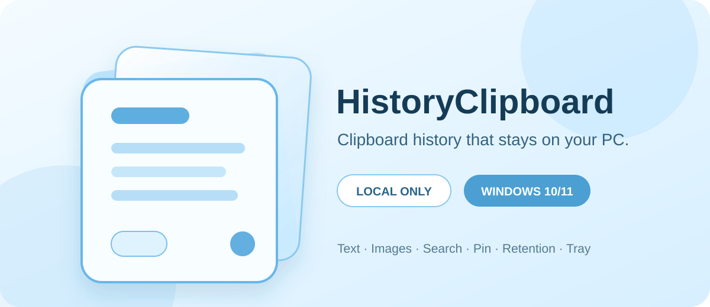

# HistoryClipboard for Windows

[简体中文](README.zh-CN.md) | English



A lightweight, privacy-first clipboard history app for Windows 10 and Windows 11.

> **Preview notice:** `0.1.0-preview.2` is an unsigned prerelease. Windows may
> show an unknown-publisher or Microsoft Defender SmartScreen warning. Verify
> the published SHA-256 checksum before running it. Do not disable Windows
> security features to install this preview.

## Privacy first

HistoryClipboard `0.1` is local-only:

- clipboard history, settings, and cached images stay on your computer;
- no telemetry, analytics, advertising, accounts, cloud service, or network
  transport is included;
- source application names, window titles, URLs, and keystrokes are not
  recorded;
- cross-device synchronization is **not implemented** in this release.

See the [privacy statement](docs/privacy.md) for storage and removal details.

## Features

- Event-driven capture of copied Unicode text and bitmap images
- Pinned-first, newest-first history
- Click a card to copy it back without duplicating the history event
- Case-insensitive text search with complete text/image inventory counts
- Pin, unpin, delete, and confirmed clear-all actions
- 1, 3, or 5 day retention for unpinned items; pinned items do not expire
- Pause and resume recording
- Tray window with active-monitor and per-monitor-DPI placement
- Configurable global shortcut: `Ctrl+Shift+V` by default
- Optional launch at sign-in for the current Windows user
- Single-instance activation and Explorer/taskbar restart recovery
- SQLite metadata and PNG image persistence under the current user profile

## Requirements

- Windows 10 or Windows 11, x64
- No separate .NET runtime is required for release packages
- The first preview is not available for ARM64

## Download and install

Download the four files for `v0.1.0-preview.2` from the
[GitHub prerelease](https://github.com/GordonNi/history-clipboard-windows/releases/tag/v0.1.0-preview.2):

- `HistoryClipboard-0.1.0-preview.2-unsigned-win-x64-setup.exe`
- `HistoryClipboard-0.1.0-preview.2-unsigned-win-x64-setup.exe.sha256`
- `HistoryClipboard-0.1.0-preview.2-unsigned-win-x64-portable.zip`
- `HistoryClipboard-0.1.0-preview.2-unsigned-win-x64-portable.zip.sha256`

The setup package installs for the current user without administrator
elevation. The portable package should be fully extracted to a writable folder
before starting `HistoryClipboard.App.exe`.

Exit the tray application before installing an update or replacing portable
files. See [installer usage](docs/installer-usage.md) and
[portable usage](docs/portable-usage.md) for detailed instructions.

### Verify SHA-256

Run this in PowerShell from the download directory:

```powershell
$file = "HistoryClipboard-0.1.0-preview.2-unsigned-win-x64-setup.exe"
(Get-FileHash -LiteralPath $file -Algorithm SHA256).Hash.ToLowerInvariant()
Get-Content -LiteralPath "$file.sha256"
```

The two 64-character values must match exactly. Repeat with the portable ZIP if
you use that package.

## Basic use

1. Start HistoryClipboard. It runs in the notification area.
2. Copy text or an image normally.
3. Press `Ctrl+Shift+V` or click the tray icon to open history.
4. Click a card to copy it back, then paste it into the destination application.
5. Open **History settings** to change retention, shortcut, recording state, or
   launch-at-sign-in.
6. Use **Exit** from the tray menu before updating or removing program files.

The shortcut can be changed to `Ctrl+Alt+V`, `Ctrl+Shift+H`, or disabled. A
shortcut conflict does not stop tray access.

## Data and uninstall behavior

Local data is stored at:

```text
%LOCALAPPDATA%\HistoryClipboard\
```

This contains `history.db`, `settings.json`, and the application-managed
`Images` directory. Removing portable program files does not remove this data.
Interactive setup uninstall asks whether to delete it and defaults to **No**.
Silent uninstall always preserves it.

## Build from source

Install the .NET 10 SDK version selected by [global.json](global.json), then run:

```powershell
dotnet restore HistoryClipboard.slnx
dotnet format HistoryClipboard.slnx --verify-no-changes
dotnet build HistoryClipboard.slnx --configuration Release --no-restore
dotnet test HistoryClipboard.slnx --configuration Release --no-build
dotnet list HistoryClipboard.slnx package --vulnerable --include-transitive
```

Build a self-contained portable package:

```powershell
& scripts\build-portable-release.ps1
& scripts\verify-portable-package.ps1
```

The per-user setup uses the project-private, version-locked Inno Setup
toolchain described in [docs/inno-setup-toolchain.md](docs/inno-setup-toolchain.md).
GUI, registry, installer round-trip, clean-machine, and mixed-DPI checks remain
separate release gates; see the [release checklist](docs/release-checklist.md).

## Project structure

```text
src/HistoryClipboard.App/             WPF app and Windows integration
src/HistoryClipboard.Core/            Clipboard history behavior
src/HistoryClipboard.Infrastructure/  SQLite, PNG, and settings persistence
tests/HistoryClipboard.Tests/         Unit and integration tests
installer/                            Per-user Inno Setup definition
scripts/                              Build and verification scripts
docs/                                 Product, technical, privacy, and release docs
.github/                              Community templates and automation
```

## Roadmap

- Complete the remaining clean Windows, mixed-DPI, manual desktop, disposable
  profile, and code-signing gates.
- Prototype explicitly paired, authenticated, end-to-end encrypted text sync
  between the macOS and Windows editions on the same trusted local network.
- Add encrypted image sync only after text sync is stable.

Synchronization, cloud relay, accounts, automatic paste injection, rich
clipboard formats, and automatic updates are not present in `0.1.0-preview.2`.

## Community

- [Contributing](CONTRIBUTING.md)
- [Security policy](SECURITY.md)
- [Support](SUPPORT.md)
- [Code of Conduct](CODE_OF_CONDUCT.md)
- [Changelog](CHANGELOG.md)

Please use private vulnerability reporting for security issues and never attach
real clipboard content, a real HistoryClipboard database, or sensitive
screenshots to a public issue.

## macOS edition

The original macOS menu-bar edition is maintained separately at
[GordonNi/history-clipboard](https://github.com/GordonNi/history-clipboard).

## License

HistoryClipboard for Windows is available under the [MIT License](LICENSE).
