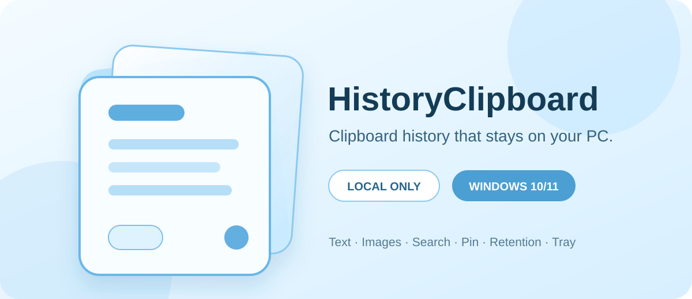

# HistoryClipboard Windows 版

简体中文 | [English](README.md)



一款适用于 Windows 10 和 Windows 11 的轻量、隐私优先剪贴板历史工具。

> **预览版提示：** `0.1.0-preview.2` 是未签名预发行版本。Windows 可能显示
> “未知发布者”或 Microsoft Defender SmartScreen 警告。运行前请核对发布页提供的
> SHA-256 校验值。不要为了安装本预览版而关闭 Windows 安全功能。

## 隐私优先

HistoryClipboard `0.1` 仅在本机工作：

- 剪贴板历史、设置和缓存图片只保存在当前电脑；
- 不包含遥测、分析、广告、账户、云服务或网络传输；
- 不记录来源应用、窗口标题、URL 或键盘输入；
- 当前版本**尚未实现**跨设备同步。

存储与删除规则详见[隐私声明](docs/privacy.md)。

## 功能

- 通过系统事件记录新复制的 Unicode 文字和位图图片
- 置顶内容优先，同组内按时间倒序排列
- 点击卡片重新复制，不会把自身写入重复记录
- 不区分大小写搜索文字，并始终显示完整文字/图片数量
- 置顶、取消置顶、删除和确认后清空全部历史
- 未置顶内容可保留 1、3 或 5 天；置顶内容不会自动过期
- 暂停和恢复记录
- 托盘窗口支持活动显示器定位和每显示器 DPI
- 可配置全局快捷键，默认为 `Ctrl+Shift+V`
- 可选当前 Windows 用户登录时启动
- 单实例唤醒及 Explorer/任务栏重启后的托盘恢复
- 使用 SQLite 保存元数据，并以 PNG 保存图片

## 系统要求

- Windows 10 或 Windows 11，x64
- 发布包已包含 .NET 运行时，无需单独安装
- 首个预览版暂不支持 ARM64

## 下载与安装

从
[GitHub 预发行页面](https://github.com/GordonNi/history-clipboard-windows/releases/tag/v0.1.0-preview.2)
下载 `v0.1.0-preview.2` 的四个文件：

- `HistoryClipboard-0.1.0-preview.2-unsigned-win-x64-setup.exe`
- `HistoryClipboard-0.1.0-preview.2-unsigned-win-x64-setup.exe.sha256`
- `HistoryClipboard-0.1.0-preview.2-unsigned-win-x64-portable.zip`
- `HistoryClipboard-0.1.0-preview.2-unsigned-win-x64-portable.zip.sha256`

安装器仅为当前用户安装，不需要管理员权限。便携版应完整解压到可写文件夹后，
再启动 `HistoryClipboard.App.exe`。

更新安装版或替换便携版文件前，请先从托盘退出程序。详细说明见
[安装器使用说明](docs/installer-usage.md)和
[便携版使用说明](docs/portable-usage.md)。

### 验证 SHA-256

在下载目录中打开 PowerShell：

```powershell
$file = "HistoryClipboard-0.1.0-preview.2-unsigned-win-x64-setup.exe"
(Get-FileHash -LiteralPath $file -Algorithm SHA256).Hash.ToLowerInvariant()
Get-Content -LiteralPath "$file.sha256"
```

两行 64 位校验值必须完全一致。使用便携版时请对 ZIP 重复验证。

## 基本使用

1. 启动 HistoryClipboard，程序会在通知区域运行。
2. 正常复制文字或图片。
3. 按 `Ctrl+Shift+V` 或点击托盘图标打开历史。
4. 点击卡片将内容放回剪贴板，再粘贴到目标应用。
5. 在“历史设置”中调整保留时间、快捷键、记录状态或登录启动。
6. 更新或删除程序文件前，从托盘菜单选择“退出”。

快捷键可改为 `Ctrl+Alt+V`、`Ctrl+Shift+H` 或禁用。快捷键冲突不会影响托盘访问。

## 数据与卸载

本地数据保存在：

```text
%LOCALAPPDATA%\HistoryClipboard\
```

其中包含 `history.db`、`settings.json` 和应用管理的 `Images` 目录。删除便携版程序
文件不会删除这些数据。交互式卸载会询问是否删除数据，并默认选择**否**；静默卸载
始终保留数据。

## 从源码构建

安装 [global.json](global.json) 指定的 .NET 10 SDK 后运行：

```powershell
dotnet restore HistoryClipboard.slnx
dotnet format HistoryClipboard.slnx --verify-no-changes
dotnet build HistoryClipboard.slnx --configuration Release --no-restore
dotnet test HistoryClipboard.slnx --configuration Release --no-build
dotnet list HistoryClipboard.slnx package --vulnerable --include-transitive
```

构建自包含便携包：

```powershell
& scripts\build-portable-release.ps1
& scripts\verify-portable-package.ps1
```

当前用户安装器使用项目私有、版本锁定的 Inno Setup 工具链，详见
[docs/inno-setup-toolchain.md](docs/inno-setup-toolchain.md)。GUI、注册表、完整安装
回归、干净系统和混合 DPI 验证仍是独立发布门禁，详见
[发布检查表](docs/release-checklist.md)。

## 项目结构

```text
src/HistoryClipboard.App/             WPF 应用与 Windows 系统集成
src/HistoryClipboard.Core/            剪贴板历史核心行为
src/HistoryClipboard.Infrastructure/  SQLite、PNG 与设置持久化
tests/HistoryClipboard.Tests/         单元测试和集成测试
installer/                            当前用户 Inno Setup 定义
scripts/                              构建和验证脚本
docs/                                 产品、技术、隐私与发布文档
.github/                              社区模板和自动化
```

## 路线图

- 完成干净 Windows、混合 DPI、真实桌面、可丢弃账户和代码签名门禁。
- 在同一可信局域网内，为 macOS 和 Windows 版原型化显式配对、身份验证和端到端
  加密的文字同步。
- 文字同步稳定后再增加加密图片同步。

`0.1.0-preview.2` 尚不包含同步、云中继、账户、自动粘贴、富文本格式或自动更新。

## 社区

- [参与贡献](CONTRIBUTING.zh-CN.md)
- [安全政策](SECURITY.zh-CN.md)
- [获取支持](SUPPORT.zh-CN.md)
- [行为准则](CODE_OF_CONDUCT.zh-CN.md)
- [更新日志](CHANGELOG.md)

安全问题请使用私密漏洞报告。不要在公开 Issue 中上传真实剪贴板内容、真实
HistoryClipboard 数据库或含敏感信息的截图。

## macOS 版本

原始 macOS 菜单栏版本位于
[GordonNi/history-clipboard](https://github.com/GordonNi/history-clipboard)。

## 许可证

HistoryClipboard Windows 版采用 [MIT License](LICENSE)。
